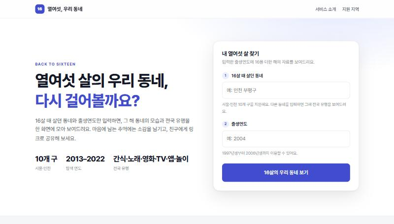
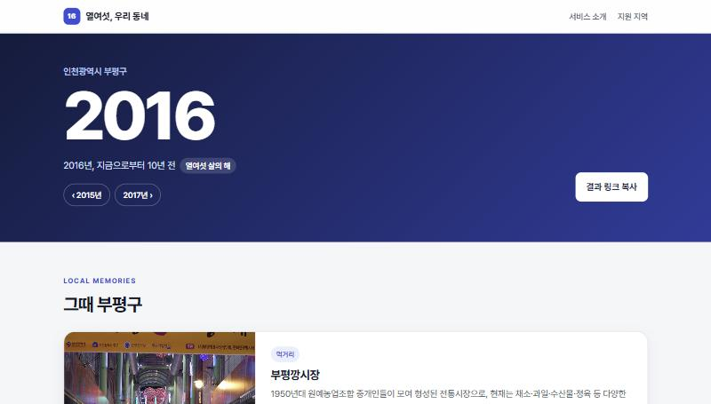
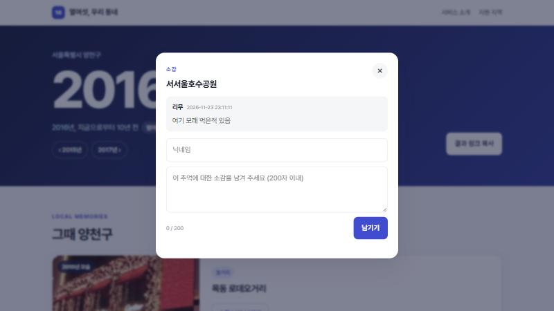
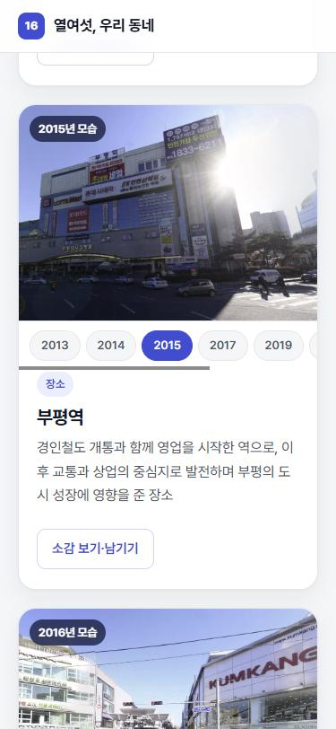

# 열여섯, 우리 동네

> 동네와 출생연도를 입력하면 **16살이던 해**의 우리 동네 추억과 그해 전국 유행을 보여주고,
> 추억마다 소감을 남기거나 결과 링크를 친구에게 공유할 수 있는 웹 서비스

소프트웨어융합학부 202417010 이아림 · VSCode + GitHub Copilot 활용 실무 프로그래밍 입문 캡스톤 프로젝트

---

## 1. 프로젝트 소개

### 해결하려는 문제
학창 시절 동네와 당시 유행을 떠올릴 자료는 개인 사진이나 여러 사이트에 흩어져 있어 한곳에서 보기 어렵고,
자료를 보며 소감을 나눌 공간도 따로 찾아야 합니다.
사전 설문(20~23세 11명)에서도 7명이 "자료를 찾지 못해 그만둔 경험이 있다"고 답했습니다. (`docs/survey_summary.md`)

### 해결 방법
| 단계 | 내용 |
|---|---|
| 입력 | 16살 때 살던 동네(입력하면 지원 구를 자동완성으로 추천), 출생연도 |
| 처리 | 입력 검증 → 탐색 연도 = 출생연도 + 16 → 지원 동네 확인 → 지역 추억·전국 유행 조회 (미지원 동네는 안내 + 전국 유행만) |
| 출력 | 지역 추억 카드(사진·연도별 모습) → 전국 유행(간식·노래·영화·TV방송·앱·게임·놀이) → 연도별 이야기 |

기준 나이 16세: 2015년 알바천국 설문에서 20대가 가장 돌아가고 싶은 나이가 평균 16.4세였던 점을 참고했습니다.

### 주요 기능
- **동네·연도 입력**: "인천 부평", "부평구", "인천 ㅂ", "ㄴㅇ"처럼 입력하면 지원하는 구를 자동완성으로 추천. 잘못된 입력·범위 밖 연도는 안내 문구 표시
- **미지원 동네**: 목록에 없는 동네를 입력하면 "아직 준비 중인 동네예요" 안내와 지원 동네 바로가기, 그해 전국 유행·연도별 이야기를 보여줌
- **지역 추억 조회**: 입력한 구와 탐색 연도에 해당하는 추억만 표시. 연도별 사진은 "○○년 모습"으로, 사진이 여러 장인 추억은 모두 함께 표시
- **추억별 댓글**: 닉네임(20자)·내용(200자) 검증, 추억마다 따로 저장. 소감이 있으면 카드에 최근 2개를 바로 보여주고, "소감 보기·남기기"를 누르면 결과 화면 위에 소감 창이 열림
- **전국 공통 유행**: 그해의 간식·노래·영화·TV방송·앱·게임·놀이 카드
- **결과 공유**: `/result?region=…&year=…` 링크 복사, 화면에는 출생연도 대신 탐색 연도와 "몇 년 전"을 표시
- **연도별 이야기**(추가 기능): 지역과 상관없는 그해 이야기를 나누는 공통 댓글창
- **이전 해 / 다음 해 이동**(추가 기능)

---

## 2. 실행 환경

| 항목 | 버전 |
|---|---|
| OS | Windows 11 (확인 환경) |
| Python | 3.14.7 |
| Flask | 3.1.3 |
| pytest | 9.2.0 |
| DB | SQLite (Python 내장 `sqlite3`, 별도 설치 불필요) |

필요한 패키지는 `requirements.txt`에 있습니다.

---

## 3. 설치 방법

PowerShell 기준입니다. 프로젝트 폴더에서 실행합니다.

```powershell
# 1) 가상환경 만들기
python -m venv .venv

# 2) 가상환경 켜기 (Git Bash는 source .venv/Scripts/activate)
.venv\Scripts\Activate.ps1

# 3) 패키지 설치
pip install -r requirements.txt

# 4) CSV 자료를 DB에 넣기 → instance/app.db 생성
python seed.py
```

`seed.py`가 끝나면 `지역 10곳, 추억 63건, 전국 유행 214건, 연도별 사진 31장을 DB에 넣었습니다.` 가 출력됩니다.
필수 칸이 비었거나 잘못된 행은 DB에 넣지 않고 `[건너뜀]` 경고를 출력합니다.

> `.env` 파일(API 키)은 **웹 앱 실행에는 필요 없습니다.** `tools/` 의 이미지 수집 도구를 다시 돌릴 때만 필요합니다.

---

## 4. 사용 방법

```powershell
python app.py
```

브라우저에서 **http://127.0.0.1:5000** 접속

1. "16살 때 살던 동네"에 동네 이름을 입력하고 추천 목록에서 고른 뒤(↑↓·Enter 또는 클릭), 출생연도(1997~2006)를 입력합니다.
   목록에 없는 동네를 그대로 입력해도 그해 전국 유행은 볼 수 있습니다.
2. 결과 화면에서 지역 추억 → 전국 유행 → 연도별 이야기 순으로 살펴봅니다.
3. 추억 카드의 "소감 보기·남기기"를 누르면 소감 창이 열립니다. 남겨진 소감은 카드에서 최근 2개를 바로 볼 수 있습니다.
4. "결과 링크 복사" 버튼으로 결과 주소를 복사해 공유합니다.
5. 상단의 이전 해 / 다음 해 버튼으로 같은 동네의 다른 연도를 봅니다.

예: 부평구 + 2002년생 → `/result?region=incheon-bupyeong&year=2018`

### 실행 화면
| 입력 화면 | 결과 화면 | 댓글 | 휴대폰 화면 |
|---|---|---|---|
|  |  |  |  |

---

## 5. 테스트 실행 방법

```powershell
python -m pytest -v
```

- 테스트는 임시 DB와 `tests/fixtures/` 의 테스트용 CSV를 사용하므로 `instance/app.db` 를 건드리지 않습니다.
- 현재 결과: **93 passed** (`tests/test_validators.py`, `tests/test_app.py`, `tests/test_tmdb_posters.py`, 2026-11-23 확인)

### 주요 테스트 (계획서 검증 기준 → 테스트)
| 계획서 검증 기준 | 테스트 |
|---|---|
| 2004년생 → 2020년 | `test_target_year_is_birth_year_plus_16` |
| 범위 밖 연도 → 이용 가능 연도 안내 | `test_out_of_range_year_shows_available_years`, `test_out_of_range_year_shows_notice` |
| 빈 입력·문자 입력 → 안내 | `test_invalid_birth_year_input`, `test_text_birth_year_shows_notice` |
| 미지원 동네 → 안내 (+ 전국 유행 표시) | `test_unsupported_region_shows_notice_and_trends`, `test_find_region_returns_none_for_unsupported` |
| 입력한 동네 이름 → 지원 구 찾기 | `test_find_region_accepts_common_names`, `test_search_finds_region_by_typed_name` |
| 자료 없음 → 안내 | `test_result_without_memories_shows_notice` |
| 해당 동네·연도 자료만 표시 | `test_result_shows_only_memories_of_region_and_year` |
| A 추억 댓글이 B 추억에 안 나타남 | `test_comment_is_saved_only_to_its_memory` |
| 빈 닉네임·빈 내용·201자 → 저장 거부 | `test_invalid_comment_is_rejected`, `test_invalid_comments_are_rejected` |
| `<script>` 댓글이 글자 그대로 저장·표시 | `test_script_comment_is_stored_as_plain_text` |
| 공유 링크 → 탐색 연도·경과 연수 표시 | `test_share_link_shows_target_year_and_years_ago` |
| 해당 연도 전국 유행만 표시 | `test_trends_of_target_year_only` |
| 검색 결과와 공유 링크 화면이 같음 | `test_share_link_opens_same_result_as_search` |
| 잘못된 URL 파라미터(연도 범위 밖·문자·빠짐) → 안내 | `test_share_link_with_bad_year_shows_notice`, `test_share_link_with_missing_params_shows_notice` |
| 잘못된 형식의 댓글 요청(목록 본문·숫자 닉네임) → 500 대신 400 | `test_comment_api_rejects_malformed_body`, `test_comment_with_non_text_values_is_rejected` |

<!-- [직접 수행] pytest 실행 화면 스크린샷 또는 로그를 기말보고서에 첨부 -->

---

## 6. MVP 체크리스트 (중간고사 계획서 기준)

| # | MVP 기능 | 상태 | 비고 |
|---|---|---|---|
| 1 | 동네·연도 입력 | ✅ 완성 | 입력 단위가 "시→구→동"에서 "구"로 바뀜 (계획 변경 1). 드롭다운 대신 자동완성 입력칸, 미지원 동네도 안내 후 전국 유행 표시 |
| 2 | 추억 자료 조회 | ✅ 완성 | 10개 구 모두 추억 자료 보유 (노원구는 마감 직전에 8건 추가) |
| 3 | 추억별 댓글 | ✅ 완성 | 추억별 분리 저장, 입력 검증, textContent 표시. 카드에 최근 소감 2개 미리보기, 소감 창(dialog) |
| 4 | 전국 공통 유행 | ✅ 완성 | 분류를 공식 순위·차트가 있는 분야로 변경 (계획 변경 7) |
| 5 | 결과 공유 | ✅ 완성 | 링크 생성·복사, 새 창에서 같은 결과 확인. 단 **서버를 배포하지 않아** 링크는 같은 PC(로컬)에서만 열림 |

### 비기능 요구사항
| 항목 | 상태 | 확인 방법 |
|---|---|---|
| 안정성 (예외 입력 5종) | ✅ | pytest (위 표) |
| 보안 (댓글 HTML 미해석) | ✅ | `static/app.js` 에서 `textContent` 사용 + 테스트 |
| 데이터 일관성 | ✅ | 추억·유행·댓글·연도별 이야기를 서로 다른 테이블로 관리 (`schema.sql`) + 테스트 |
| 사용성 (처음 쓰는 3명, 30초 이내) | ⬜ 미측정 | <!-- [직접 수행] 측정했다면 결과 기록, 아니면 이유 기록 --> |

### MVP 이후 항목 (계획서 "추후 개선")
댓글 신고, 지도 기반 비교, 결과 이미지 저장 → **모두 미구현** (MVP 완성과 자료 조사를 우선함)

---

## 7. 계획 변경 사항

자세한 내용은 [`docs/plan_changes.md`](docs/plan_changes.md)에 있습니다.

| 계획서 | 변경 | 이유 |
|---|---|---|
| 행정동 20곳 (서울·인천 각 10곳) | **자치구 10곳** (서울 5, 인천 5) | 동 단위 과거 자료는 출처 확인이 어렵고, 조사 시간이 부족함 |
| 선정 기준: 2026년 6월 총인구 | **2016년 12월 15~19세 거주자** | 서비스가 2010년대를 보여주므로 당시 16세 무렵 인구가 적합 (`docs/dong_selection.md`) |
| 탐색 연도 2010~2023 | **2013~2022** (출생연도 1997~2006) | 조사량 축소. 계획서의 목표 사용자 16세 연도 범위와 같음 |
| 추억을 지역·연도별로 등록 | **기간형**(시작~끝 연도) + 빠진 해(`skip_years`) | 같은 장소가 여러 해 존재하므로 연도마다 따로 조사할 필요가 없음 |
| 사진 여부 미정 | 추억 사진 + **연도별 사진** | 설문 11명 중 8명이 "사진으로 확인하고 싶었다"고 응답 |
| 전국 유행: 음식·패션·놀이·대중문화 | **간식·노래·영화·TV방송·앱·게임·놀이** | 음식·패션은 공식 순위가 없어 근거 확인이 어려움 |
| 자료별 출처 필수 | 출처는 **선택 항목** | 블로그 언급 분석 + 기사 확인 방식이라 단일 출처 링크를 붙이기 어려움 |
| 댓글은 추억별로만 | **연도별 이야기** 추가 | 설문 10/11명이 "비슷한 기억 공유"를 가장 중요하게 꼽음 |
| 외부 블로그 자동 수집 제외 | 네이버 블로그 검색 API를 **조사 후보 발굴에만** 사용 | 블로그 글을 화면에 가져오지 않으므로 제외 범위의 취지와 다르지 않음 |
| 사전 설문 8주차 전 | 10월 말~11월 초 진행 (11명) | 일정 지연. 목표 인원(5명)은 넘김 |

---

## 8. 프로젝트 구조

```
app.py            Flask 서버 (화면 라우트 + 댓글 API)
config.py         연도 범위·댓글 길이·유행 분류 등 설정값
validators.py     입력 검증·연도 계산 (Flask·DB와 분리된 순수 함수)
database.py       SQLite 조회·저장 함수
schema.sql        테이블 구조 (regions, memories, memory_photos, trends, comments, year_comments)
seed.py           data/*.csv → instance/app.db 적재 (잘못된 행은 건너뜀)
data/             조사한 자료 CSV
templates/        HTML (Jinja2)
static/           app.js(소감 창·미리보기·링크 복사), search.js(동네 자동완성), style.css, images/ (memories/<구>/, trends/<연도>/)
tests/            pytest 테스트와 테스트용 CSV
tools/            이미지 수집 도구 (TMDB·IGDB·iTunes), 웹 앱과 별개
docs/             계획 변경·디버깅·리팩토링·설문·지역 선정·이미지 출처 기록
```

### 데이터 현황
| 자료 | 건수 |
|---|---|
| 지원 지역 | 10개 구 (서울 노원·강남·송파·양천·강서 / 인천 서구·부평·남동·연수·계양) |
| 지역 추억 | 63건 (10개 구) |
| 연도별 사진 | 31장 |
| 전국 유행 | 214건 (2013~2022) |

---

## 9. 개발 과정

### Copilot Chat 활용
- **기획**: 목적·입력 정보·원하는 출력·제약조건 형식으로 프롬프트를 작성해 문제 원인과 기능 우선순위를 도출하고,
  근거가 부족한 추측은 사용자 설문으로 검증할 가설로 분리했습니다.
- **구현**: <!-- [직접 작성] 예: 주석 프롬프트로 validate_comment 초안을 받고 테스트로 검증·수정한 사례 -->

### 디버깅 (전체 17건: [`docs/debugging.md`](docs/debugging.md))
- **템플릿 자동 정렬 오류**: 메인 화면에서 `TemplateSyntaxError`가 나고 테스트 4개가 실패했습니다.
  VSCode의 HTML 자동 정렬이 Jinja 문법 ``를 HTML 속성으로 잘못 바꾼 것이 원인이었습니다.
  원래 문법으로 복구하고 `.prettierignore`에 `templates/`를 추가해 재발을 막았습니다.
- **테스트로 발견한 정규식 오류**: 노래방 버전을 거르는 테스트가 실패해서 확인해 보니,
  정규식의 `\b`가 파일에 저장되는 과정에서 백스페이스 문자로 바뀌어 있었습니다. `cat -A`로 확인한 뒤 고쳤습니다.
- **CSV에서 지운 행이 DB에 남는 문제**: `INSERT OR REPLACE`는 사라진 행을 지우지 않아서,
  댓글이 연결되지 않는 전국 유행은 적재할 때마다 테이블을 새로 만들도록 바꿨습니다.

### AI 도구 사용 구분
- **GitHub Copilot** (자동완성·Chat): <!-- [직접 작성] Copilot으로 한 작업 -->
- **Claude Code**: <!-- [직접 작성] Claude Code로 한 작업 --> 2026-11-23 최종 점검(예외 입력 점검, 디버깅 14~17번 수정, 테스트 7개 추가, 리팩토링 3번)은 Claude Code로 진행했습니다. <!-- [직접 수행] 변경 내용을 검토한 뒤 이 주석을 지우세요 -->

### 코드 리뷰 반영
<!-- [직접 작성] Copilot Chat 코드 리뷰에서 지적받아 고친 사례 1~2개 -->
- 지역 추억 댓글과 연도별 이야기가 같은 검증 규칙을 쓰도록 `save_comment()` 한 곳으로 모았습니다. (`app.py`)

### 리팩토링 ([`docs/refactoring.md`](docs/refactoring.md))
- **전**: TMDB 포스터 도구 하나에 `.env` 읽기, CSV 읽기·저장, 이미지 다운로드, 연도 비교가 모두 들어 있었습니다.
  IGDB 도구를 추가하려면 같은 코드를 또 써야 했습니다. (`docs/refactoring/before_fetch_tmdb_posters.py`)
- **후**: 공통 기능을 `tools/common.py`로 분리했습니다. 연도 비교는 "연도를 꺼내는 함수"를 인자로 받는
  `choose_closest_year(candidates, year, year_of)`로 바꿔 TMDB·IGDB·iTunes 도구가 함께 씁니다.
- **검증**: 리팩토링 전후로 같은 테스트가 통과하는지 확인했습니다.
- **결과 화면 JS 요청 처리**: 소감 목록 불러오기·저장이 각자 `fetch`를 처리하고 실패를 처리하지 않아, 서버가 꺼지면 안내 없이 빈 화면이었습니다.
  `requestJson()` 하나로 모으고 "서버에 연결하지 못했어요" 같은 안내를 보여주도록 바꿨습니다. (리팩토링 기록 3번)
- 그 밖에 숫자 설정값(연도 범위, 댓글 길이, 분류)을 `config.py`에, 입력 검증을 `validators.py`에 모아 한 곳만 고치면 되도록 했습니다.

---

## 10. 한계와 개선 방향

- **연도를 바꿔도 지역 추억이 비슷함**: 장소·먹거리는 대부분 2013~2022 전체 기간이라 이웃한 해의 지역 추억이 같은 경우가 많습니다 (10개 구 × 이웃한 해 90쌍 중 52쌍). 축제는 기사로 개최 연도를 확인해 빠진 해를 넣었고(계획 변경 22), 강서·양천·강남·계양처럼 장소 위주인 구는 연도별 차이가 작습니다.
- **지역별 자료 편차**: 구마다 추억이 4~8건으로 차이가 있고, 연도별 사진은 부평구·노원구에 집중되어 있습니다.
- **출처 기록 부족**: 출처 링크가 있는 지역 추억은 축제 등 일부(10건)이고, 일부 사진의 원 게시글·작성자를 기록하지 못했습니다. (`docs/image_sources.md`)
- **배포하지 않음**: 공유 링크는 로컬에서만 열립니다. 포스터·앨범 커버·로드뷰 캡처는 저작권 때문에 웹에 공개하지 않고 시연용으로만 사용합니다.
- **댓글 관리 기능 없음**: 로그인·삭제·신고·도배 방지가 없어 공개 서비스로 쓰려면 보완이 필요합니다.
- **설문 표본**: 11명, 인천 출신 9명으로 치우쳐 있습니다.

---

## 11. 자료 출처
- 알바천국 보도자료, 뉴스와이어, 2015.2.11.
- 행정안전부 주민등록 인구통계 「행정동별 연령별 인구현황」 (2016년 12월)
- 영화·TV방송 포스터: TMDB API (This product uses the TMDB API but is not endorsed or certified by TMDB.)
- 게임 표지: IGDB API / 앨범 커버: iTunes Search API
- 이미지별 출처와 수집 방법: [`docs/image_sources.md`](docs/image_sources.md)
